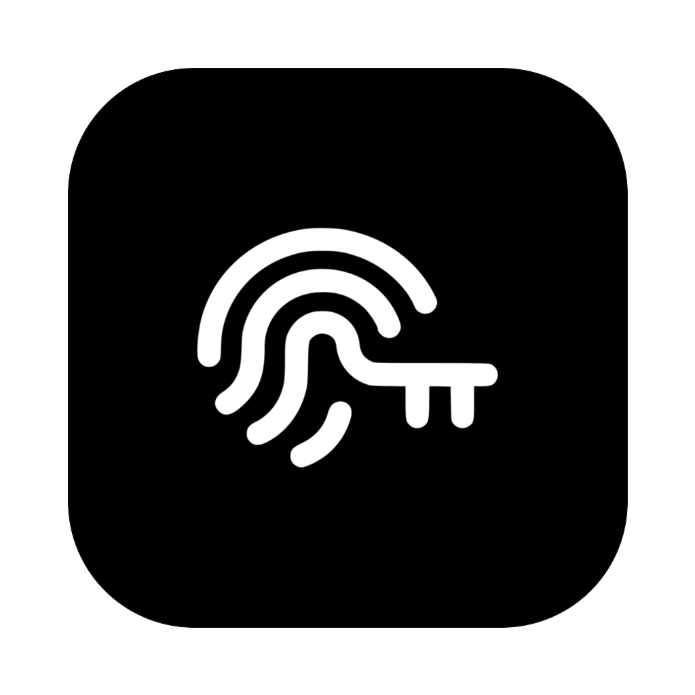

<p align="center"></p>

# NodWarden

Approve each AI agent's request for a Bitwarden secret from your MacBook's notch,
with Touch ID.

Agents ask for one credential through [Bitwarden Agent Access](https://github.com/bitwarden/agent-access)
(`aac run`). NodWarden grows out of the notch and shows the site, the username,
whether 2FA is included, and which device is asking. You approve with Touch ID.
The agent receives that one secret in its child process's environment. It never
gets your vault.

## How it works

```
agent ──aac run──▶ relay (E2E, Noise) ──▶ aac-core ──bw get──▶ your vault
                                             ▲  │
                                  stdin pipe │  │ stdout pipe (no secrets)
                                             │  ▼
                                         NodWarden (notch UI, Touch ID)
```

- `aac-core` is a headless Agent Access listener built on Bitwarden's
  `ap-client` (pinned to the same commit as `aac` 0.11.0). It reads and writes the
  same `~/.access-protocol` pairing files as `aac listen`.
- Only NodWarden can answer an approval: the only channel is the private stdin pipe of the
  child process. Every Allow needs Touch ID, so a synthetic click does nothing.
- The vault session comes from Touch ID through Bitwarden Desktop (`bwbio`). It goes
  straight into `aac-core`'s stdin, never into argv or the environment of a visible process.
- Quitting NodWarden runs `bw lock`.
- Only reusable-PSK pairing is accepted; rendezvous pairing is refused.

## Requirements

- macOS 14+, Apple silicon. Without a notch, NodWarden hangs from the menu bar as a pill.
- [Bitwarden CLI](https://bitwarden.com/help/cli/) (`bw`), logged in.
- [Bitwarden Desktop](https://bitwarden.com/download/) with Touch ID unlock enabled.
- [`bwbio`](https://github.com/jeanregisser/bitwarden-cli-bio) **≥ 1.4.3**.
- [`aac`](https://github.com/bitwarden/agent-access) 0.11.0 on the agent side, paired with a reusable PSK.
- Rust and Xcode command line tools to build.

## Build

```sh
./build.sh          # builds aac-core + the app, installs ~/Applications/NodWarden.app
open ~/Applications/NodWarden.app
```

To start it at login, add `~/Applications/NodWarden.app` to System Settings → General → Login Items.

If `bw`/`bwbio`/`node` live somewhere unusual, set `NODWARDEN_PATH` to a PATH string.

## Agent side

```sh
export AAC_TOKEN=<reusable PSK token>
aac run --domain github.com --env GH_TOKEN=password -- gh auth status
aac run --id <vault-item-uuid> --env DB_PASS=password -- ./deploy.sh
```

When more than one vault item matches a domain, the request is denied. Use `--id`.
Don't use `aac connect --output json` for real secrets: it prints them to stdout.

## Known limits

- An agent running as your user can still call `bwbio unlock --raw` itself. That shows
  a bare Touch ID prompt with no NodWarden request. Never approve a Touch ID prompt that
  NodWarden did not start.
- Vaultwarden older than 1.37.4 can't log in with `bw` 2026.9.0+ (`KeyIdBackfillError`).
  Upgrade the server, or pin `bw` 2026.8.0.
- Agent Access is an early preview. Its protocol may change.

## License

Apache-2.0. `core/src/storage/*` is copied unmodified from
[bitwarden/agent-access](https://github.com/bitwarden/agent-access) (Apache-2.0, © Bitwarden Inc.).
NodWarden is not affiliated with or endorsed by Bitwarden.
