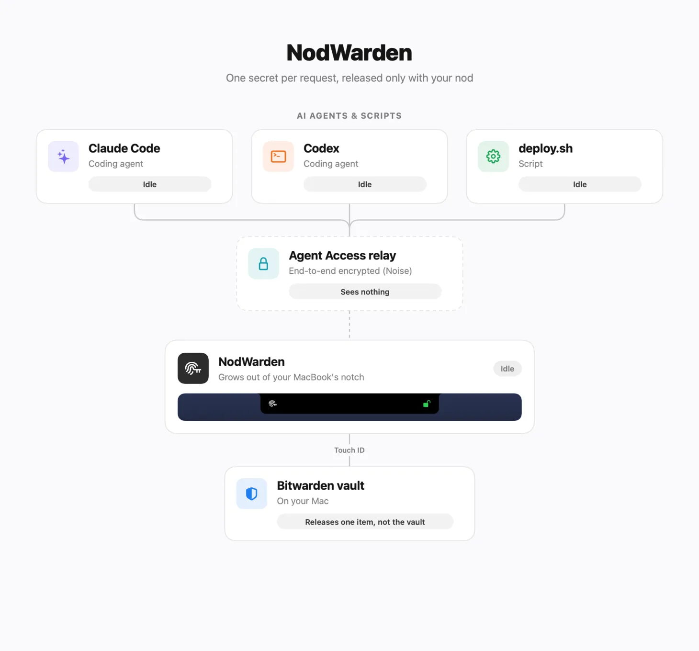
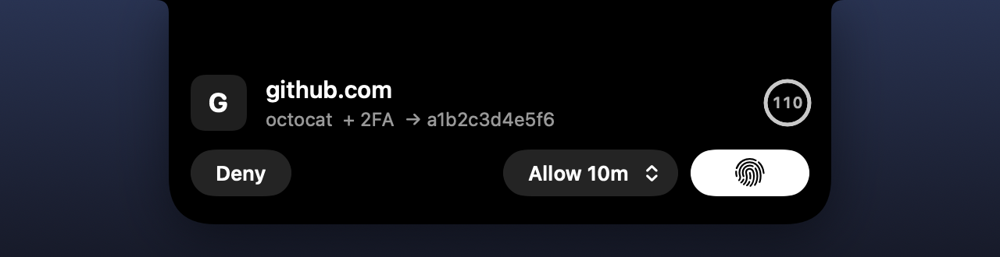
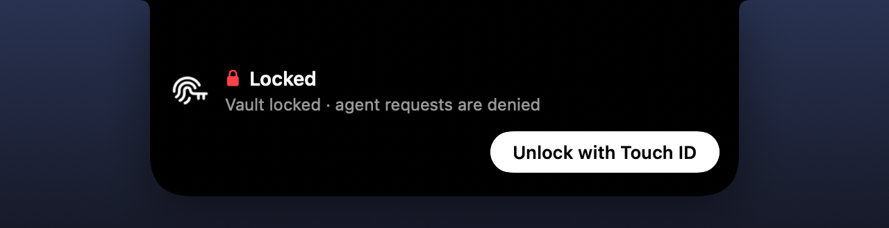
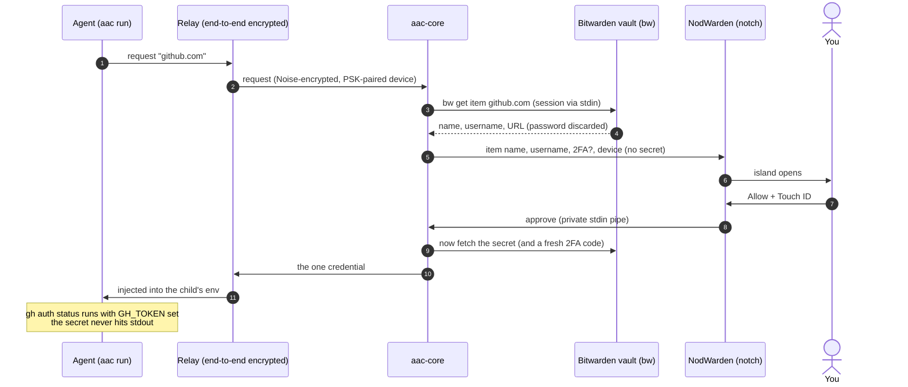
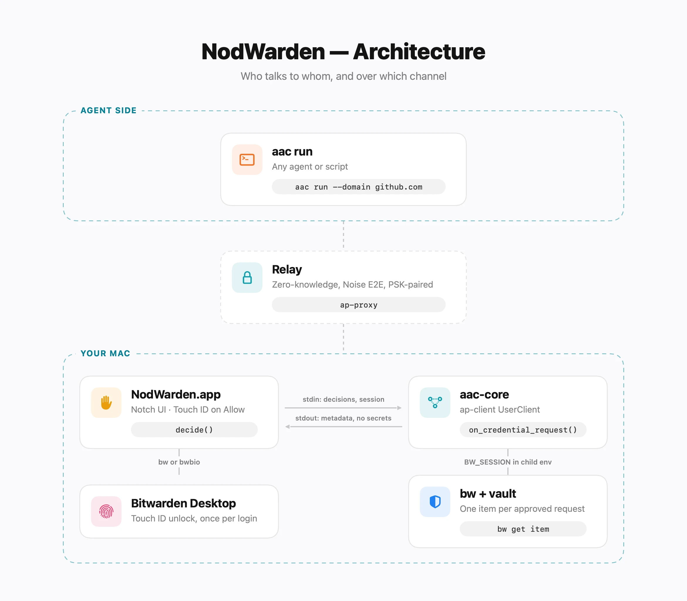
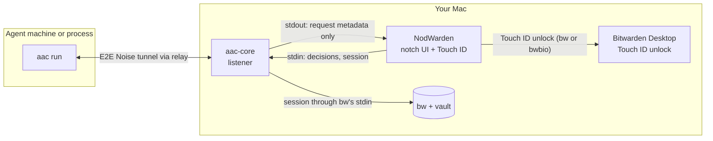

<p align="center">
  <picture>
    <source media="(prefers-color-scheme: dark)" srcset="assets/logo-dark.png">
    <source media="(prefers-color-scheme: light)" srcset="assets/logo-light.png">
    
  </picture>
</p>

# NodWarden

NodWarden lets AI agents use credentials from your Bitwarden vault without ever getting the vault.
Each request appears in your MacBook's notch, shows exactly which secret is being asked for and who
is asking, and is released only after you approve it with Touch ID.

NodWarden is a macOS front end for [Bitwarden Agent Access](https://github.com/bitwarden/agent-access).
Agents use the standard `aac` client; NodWarden replaces the listener on your Mac.

> [!WARNING]
> **Alpha (0.0.x).** NodWarden is very early software, and it builds on Bitwarden Agent Access, which is
> itself in early preview. Expect breaking changes. Always use `aac run`, so the secret goes to the
> process, never into the model's context.

<p align="center">
  <picture>
    <source media="(prefers-color-scheme: dark)" srcset="assets/overview-dark.webp">
    <source media="(prefers-color-scheme: light)" srcset="assets/overview-light.webp">
    
  </picture>
</p>

## The problem

Coding agents need real credentials: an API token to deploy, a database password to run a
migration, a GitHub login to open a PR. The usual ways to give them one are all bad:

| What people do | What goes wrong |
|---|---|
| Put the secret in `.env` or the shell | Every agent, script and process can read it, all the time. |
| Paste it into the chat | It's now in the model's context, logs and transcripts. |
| Unlock the whole vault (`export BW_SESSION=…`) | The agent can read *everything*: `bw list items`, `bw export`. |
| Approve with a bare Touch ID prompt | You can't see what you're approving. One touch can hand over the whole vault. |

1Password's CLI asks for approval, but the Bitwarden CLI doesn't. Bitwarden's own answer,
[Agent Access](https://github.com/bitwarden/agent-access), releases one item per request, but its
approval screen is a terminal TUI. It's easy to miss, and anything on your machine that can
type into that terminal can approve for you.

## What NodWarden does

**One secret per request. You see exactly what it is. Only your finger releases it.**

- The agent asks for one item (`aac run --domain github.com …`), never the vault.
- The notch grows open and shows the item's own name, the username, whether a current 2FA code comes with it,
  which device is asking, and a countdown.
- Touch ID starts as soon as a request appears on an empty island: touch the sensor to allow. When
  requests queue up, or one follows another within two seconds, the next one waits for a click, so one
  touch can't release two things. The fingerprint fills red
  as it's released. Cancel the prompt and the request stays open; click **Allow** to bring Touch ID
  back. **Allow 10m** auto-approves the same device and item for a window
  you choose (5–60 min). **Deny**, or no answer within 110 s, refuses the request.
- The secret goes into the environment of the agent's child process only. It never reaches
  stdout, so it stays out of the model's context.

### SSH and git signing too

NodWarden also runs an SSH agent with the SSH keys from your Bitwarden vault. Every login and every
git commit signature shows in the notch (host, key, purpose, and the app asking) and needs Touch ID,
like 1Password's SSH agent. Bitwarden's own SSH agent only asks for a click.

```
# ~/.ssh/config
Host *
  IdentityAgent "~/.nodwarden/ssh-agent.sock"
```

For signed commits, set `gpg.format = ssh` and `gpg.ssh.program = ssh-keygen` in git; signing then
goes through the same agent. Keys load when the vault unlocks and are wiped from memory when it locks.
Turn off Bitwarden Desktop's own SSH agent so only one agent holds your keys.

## How it works

### What you see

| State | Notch |
|---|---|
| **Idle, unlocked.** The mark sits beside the notch with a green open lock (red when locked). |  |
| **Request.** The island grows down with everything you need to decide. |  |
| **Released.** A short confirmation, then it folds back. |  |
| **Locked.** Click the island to unlock with Touch ID. Locked = every request is denied. |  |

### One request, end to end



### Who can talk to whom

<p align="center">
  <picture>
    <source media="(prefers-color-scheme: dark)" srcset="assets/architecture-dark.webp">
    <source media="(prefers-color-scheme: light)" srcset="assets/architecture-light.webp">
    
  </picture>
</p>

<details>
<summary>Same diagram as text</summary>




</details>

### What it protects against

| Attack | Why it fails |
|---|---|
| Agent types `y` into the approval prompt | There is no prompt to type into. The only approval channel is NodWarden's private stdin pipe to `aac-core`. |
| Script clicks **Allow** or types your password (AppleScript, Accessibility) | Allow needs Touch ID. The login password and Apple Watch are not accepted. |
| Agent reads the vault session from `ps` while `bw` runs | `bw` gets the session through its stdin, set inside the process. It never appears in any process's argv or environment. |
| Agent sends many requests to fish out the session | Nothing secret leaves `aac-core` before approval: the lookup keeps only the item's name, username and URL. At most 3 requests per device are in progress at once. |
| Agent fakes the host or purpose of an SSH signature | The host comes from a verified `session-bind` (the server's host key must sign the session). A login is only labelled a login if the data is exactly a userauth request for that session and that key. Anything else is shown as "unverified data". |
| A host you reached with `ssh -A` uses your agent | The request is shown as forwarded from that host, needs Touch ID every time, and no Allow window applies to it. |
| Agent reuses your "Allow 10m" | A window covers one key, the shell or agent session it was opened from, and one purpose: logins to one verified host, or git commit signing (the `git` namespace only). Another terminal tab, another agent, another host, another purpose or a forwarded request asks again. A program you start from that same shell or agent while the window is open can use it. |
| A fake `bw` or `node` planted on PATH | Tools are resolved to absolute paths at start. A path that another user could change is refused (administrators excepted: they can already use `sudo`). Both binaries run with hardened runtime. |
| A new device tries to pair | Only your reusable PSK is accepted. Rendezvous pairing is refused. |
| You walk away | Requests time out after 110 s. Sleep, screen lock, switching to another user, or 15 minutes without keyboard or mouse input locks NodWarden: keys and approval windows are cleared and `bw lock` runs. An "Allow 60m" window ends at the idle lock. |

`aac-core` is a headless Agent Access listener built on Bitwarden's `ap-client`, pinned to the
same commit as `aac` 0.11.0. It uses the same `~/.access-protocol` pairing files as
`aac listen`, so existing agents need no changes.

## Requirements

- macOS 14+, Apple silicon. Without a notch, NodWarden hangs from the menu bar as a pill.
- [Bitwarden CLI](https://bitwarden.com/help/cli/) (`bw`), logged in. It must be the Node build
  (`npm install -g @bitwarden/cli`, or Homebrew), with `node` installed. The standalone binary download is
  refused: NodWarden hands `bw` the session through Node's stdin so that it never shows in a process environment.
- [Bitwarden Desktop](https://bitwarden.com/download/) with Touch ID unlock enabled.
- For Touch ID unlock, **one** of:
  - `bw` **≥ 2026.10.0** with the server flag `biometrics-sdk-ipc` on. On Vaultwarden ≥ 1.37.5, set
    `EXPERIMENTAL_CLIENT_FEATURE_FLAGS=biometrics-sdk-ipc`. On bitwarden.com, it's on once Bitwarden enables it.
  - [`bwbio`](https://github.com/jeanregisser/bitwarden-cli-bio) **≥ 1.4.3**, which works with any server.

  NodWarden tries official `bw` first, then `bwbio`.
- [`aac`](https://github.com/bitwarden/agent-access) 0.11.0 on the agent side, paired with a reusable PSK.
- Rust and Xcode command line tools to build.

## Build

```sh
./build.sh          # builds aac-core + the app, installs ~/Applications/NodWarden.app
open ~/Applications/NodWarden.app
```

To start it at login, turn on **Open at login** in its Settings (click the island, ⚙ → Settings). If
macOS asks, allow it in System Settings → General → Login Items.

If `bw`/`bwbio`/`node` live somewhere unusual, set `NODWARDEN_PATH` to a PATH string.
`~/Applications/NodWarden.app/Contents/MacOS/nodwarden --tools` prints which ones NodWarden will run.

## Agent side

```sh
export AAC_TOKEN=<reusable PSK token>
aac run --domain github.com --env GH_TOKEN=password -- gh auth status
aac run --id <vault-item-uuid> --env DB_PASS=password -- ./deploy.sh
```

When more than one vault item matches a domain, the request is denied. Use `--id`.
Don't use `aac connect --output json` for real secrets: it prints them to stdout.

**Pairing token.** On first run, NodWarden shows a reusable token in the status panel (click the
island); Copy keeps it on this Mac only. The relay must be reachable to make a token.

**Agents.** Click the island, then ⚙. It lists paired devices and tokens, with when each token was
last used and by which device (recorded by NodWarden from 0.0.2 on). From there you can make a
named token, rename a device or token, remove one, or revoke everything. Removing takes Touch ID.
Agent connections drop for a couple of seconds while the list is applied; the vault and the SSH
agent stay as they are.

**History.** Click the island, then ⚙ → History: what was asked, by which program or device, and
what happened (allowed, auto, denied, timed out). It is kept in memory only and cleared when NodWarden
quits. Hosts, item names and usernames there and in the Allow list are hidden under a spoiler until you
click them, so a screenshot or screen recording of the notch doesn't show them.

**Settings.** ⚙ → Settings: hiding hosts and names (in lists, and optionally in requests), keeping
history, idle lock (Never to 1 hour), locking on sleep, offering Allow-for-N-minutes, starting Touch ID
by itself, the sound, working from the offline copy, and opening at login. No setting can skip Touch
ID: at most it hides more or asks more often.

**Without the relay.** The SSH agent and unlock work offline; only agent credential requests need the
relay.

**Without your vault server.** NodWarden unlocks from the copy of the vault on this Mac, so SSH keys
and secrets keep working. The panel marks it as an offline copy, and NodWarden keeps trying the server
by itself (and right away when the network comes back) until a sync goes through.

**Idle lock.** NodWarden locks after 15 minutes without keyboard or mouse input. Change it with
`defaults write io.github.nodwarden idleLockMinutes -int 30`, or `0` to turn it off.

## Security model

### What NodWarden guarantees

- An agent never receives your vault or a vault session, only the one item you approved.
- Nothing is released without Touch ID, except inside an Allow window that you opened with Touch ID.
  Nothing but NodWarden can approve.
- You see the item's own name, username and requesting device before you decide. For SSH: the verified
  host, the purpose, and the program asking.
- Secrets go into the agent's child process environment, never to NodWarden's stdout or logs.
- Locking (button, sleep, screen lock, user switch, idle, or a locked vault) clears keys and approval
  windows and runs `bw lock`. If the app crashes or is force-quit, the core still runs `bw lock` before
  it exits.

### What's outside any app's control

NodWarden controls what goes through NodWarden. Two things running as **your own macOS user** don't:

- **Bitwarden Desktop's own Touch ID unlock.** Any program running as you can ask Desktop to unlock the
  vault (that's how the browser extension, `bwbio` and `bw unlock` work), and the prompt reads the same
  *"unlock your vault"* no matter who asked. This is true on any Mac with Bitwarden Desktop and Touch ID,
  with or without NodWarden.
- **Your own files.** A program running as you can replace files you own, including the `bw` CLI in your
  home folder.

So NodWarden protects you from agents on **other machines** completely, and from local agents as long as
they don't attack your user account itself. Two ways to close the rest:

- **Best:** run agents as a separate macOS user, or in a VM or container. They can't reach your Desktop app
  or your files, and they still get secrets through NodWarden.
- **Simple:** only touch Touch ID prompts that NodWarden started. NodWarden always shows its request in
  the notch first.

### Compatibility notes

- Vaultwarden older than 1.37.4 can't log in with `bw` 2026.9.0+ (`KeyIdBackfillError`).
  Upgrade the server, or pin `bw` 2026.8.0.
- Agent Access is an early preview. Its protocol may change.

## FAQ

**Do I need `bwbio`?**
Only if official `bw` Touch ID isn't available to you. It needs `bw` 2026.10.0+ and the server flag
`biometrics-sdk-ipc`. NodWarden tries official `bw` first and uses `bwbio` only as a fallback.
With neither, NodWarden cannot unlock the vault.

**Why not just use `aac listen` and put a GUI on top?**
`aac listen` is a terminal program: you approve by pressing `y`. Any process running as you, including the agent,
can send that key. NodWarden runs its own listener on Bitwarden's `ap-client`, so only NodWarden can answer.
Agents still use the standard `aac run`.

**Why not let Bitwarden Desktop handle requests?**
It doesn't support Agent Access. NodWarden only uses it for Touch ID unlock.

**Why not `bw serve`, or Touch ID before every `bw` command?**
Both hand out the whole vault. `bw serve` has no approval step. A bare Touch ID prompt doesn't show what you're
approving, and one touch gives a full session. NodWarden releases one item, and you see which one.

**Why Touch ID on Allow?**
A script can click a button, or even type your password. It can't touch the sensor. NodWarden accepts only
Touch ID (no password, no Apple Watch), so with the lid closed and no Touch ID keyboard, nothing can be approved.

**Why a relay?**
Agent Access uses one, so agents can run on other machines. It's end-to-end encrypted, so it can't read your secrets,
but it does see connection metadata.

**Does it work with Vaultwarden? 1Password?**
It works with both bitwarden.com and Vaultwarden. 1Password isn't supported; its CLI has its own approval prompt.

**Is it secure?**
For everything that goes through it, yes: agents get one approved item, never the vault or its session, and
only your finger releases it. It can't control what any program running as your own user can already do,
like triggering Bitwarden Desktop's Touch ID unlock. Run agents as a separate macOS user to rule that out.
See [Security model](#security-model).

**Does it phone home?**
No. NodWarden makes no network requests of its own. `aac-core` talks only to the Agent Access relay,
and `bw` talks to your Bitwarden server as it always does.
Item icons are drawn locally from the name's first letter.

**Where are the logs?**
`~/Library/Logs/NodWarden/aac-core.log`, readable only by you. Secrets are never written there.

## License

Apache-2.0. `core/src/storage/*` is copied unmodified from
[bitwarden/agent-access](https://github.com/bitwarden/agent-access) (Apache-2.0, © Bitwarden Inc.).
NodWarden is not affiliated with or endorsed by Bitwarden.

## Docs artwork

The README images are rendered from code. `swift docs/diagrams.swift` redraws the static images;
`docs/animate.sh` redraws the animated overview (needs ImageMagick and `img2webp`).
