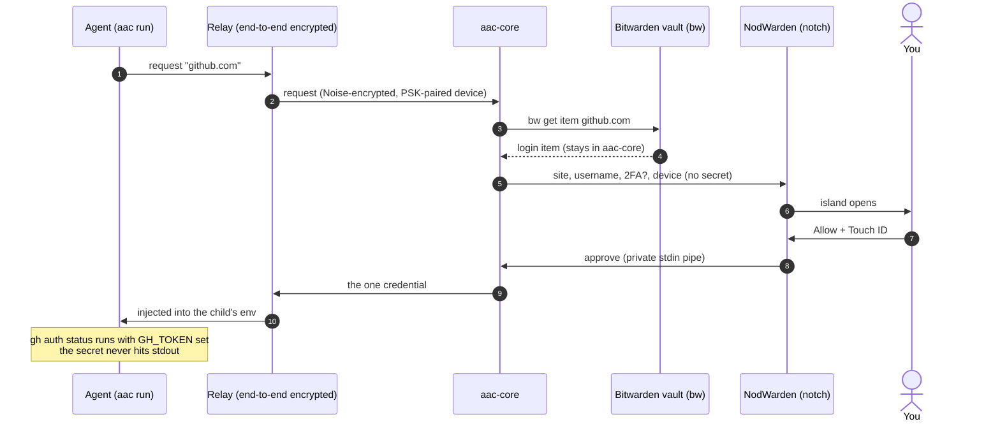
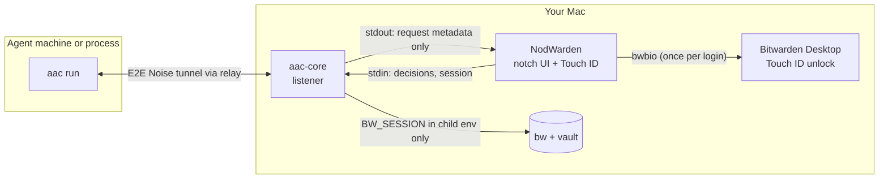

<p align="center">
  <picture>
    <source media="(prefers-color-scheme: dark)" srcset="assets/logo-dark.png">
    <source media="(prefers-color-scheme: light)" srcset="assets/logo-light.png">
    
  </picture>
</p>

# NodWarden

NodWarden lets AI agents use credentials from your Bitwarden vault without ever getting the vault.
Each request appears in your MacBook's notch, shows exactly which secret is being asked for and who
is asking, and is released only after you approve it with Touch ID.

NodWarden is a macOS front end for [Bitwarden Agent Access](https://github.com/bitwarden/agent-access).
Agents use the standard `aac` client; NodWarden replaces the listener on your Mac.

> [!IMPORTANT]
> Agent Access is in **early preview**, and so is NodWarden. Don't paste secrets into an LLM chat.
> Use environment injection (`aac run`) so the secret goes to the process, never into the model's context.

<p align="center">
  <picture>
    <source media="(prefers-color-scheme: dark)" srcset="assets/overview-dark.webp">
    <source media="(prefers-color-scheme: light)" srcset="assets/overview-light.webp">
    
  </picture>
</p>

## The problem

Coding agents need real credentials: an API token to deploy, a database password to run a
migration, a GitHub login to open a PR. The usual ways to give them one are all bad:

| What people do | What goes wrong |
|---|---|
| Put the secret in `.env` or the shell | Every agent, script and process can read it, all the time. |
| Paste it into the chat | It's now in the model's context, logs and transcripts. |
| Unlock the whole vault (`export BW_SESSION=…`) | The agent can read *everything*: `bw list items`, `bw export`. |
| Approve with a bare Touch ID prompt | You can't see what you're approving. One touch can hand over the whole vault. |

1Password's CLI asks for approval, but the Bitwarden CLI doesn't. Bitwarden's own answer,
[Agent Access](https://github.com/bitwarden/agent-access), releases one item per request, but its
approval screen is a terminal TUI. It's easy to miss, and anything on your machine that can
type into that terminal can approve for you.

## What NodWarden does

**One secret per request. You see exactly what it is. Only your finger releases it.**

- The agent asks for one item (`aac run --domain github.com …`), never the vault.
- The notch grows open and shows the site, the username, whether a 2FA code comes with it,
  which device is asking, and a countdown.
- **Allow** needs Touch ID. **Allow 10m** auto-approves the same device and item for a window
  you choose (5–60 min). **Deny**, or no answer within 110 s, refuses the request.
- The secret goes into the environment of the agent's child process only. It never reaches
  stdout, so it stays out of the model's context.

## How it works

### What you see

| State | Notch |
|---|---|
| **Idle, unlocked.** The mark sits beside the notch with a green dot. |  |
| **Request.** The island grows down with everything you need to decide. |  |
| **Released.** A short confirmation, then it folds back. |  |
| **Locked.** Click the island to unlock with Touch ID. Locked = every request is denied. |  |

### One request, end to end



### Who can talk to whom

<p align="center">
  <picture>
    <source media="(prefers-color-scheme: dark)" srcset="assets/architecture-dark.webp">
    <source media="(prefers-color-scheme: light)" srcset="assets/architecture-light.webp">
    
  </picture>
</p>

<details>
<summary>Same diagram as text</summary>




</details>

### Why it's hard to bypass

| Attack | Why it fails |
|---|---|
| Agent types `y` into the approval prompt | There is no prompt to type into. The only approval channel is NodWarden's private stdin pipe to `aac-core`. |
| Script clicks **Allow** (AppleScript, Accessibility) | Every Allow also requires Touch ID. A click alone does nothing. |
| Agent reads the vault session from `ps` or env | The session goes from Touch ID straight into `aac-core`'s stdin. It never appears in argv or the environment of a visible process. |
| A new device tries to pair | Only your reusable PSK is accepted. Rendezvous pairing is refused. |
| You walk away | Requests time out and are denied after 110 s. Quitting NodWarden runs `bw lock`. |

`aac-core` is a headless Agent Access listener built on Bitwarden's `ap-client`, pinned to the
same commit as `aac` 0.11.0. It uses the same `~/.access-protocol` pairing files as
`aac listen`, so existing agents need no changes.

## Requirements

- macOS 14+, Apple silicon. Without a notch, NodWarden hangs from the menu bar as a pill.
- [Bitwarden CLI](https://bitwarden.com/help/cli/) (`bw`), logged in.
- [Bitwarden Desktop](https://bitwarden.com/download/) with Touch ID unlock enabled.
- [`bwbio`](https://github.com/jeanregisser/bitwarden-cli-bio) **≥ 1.4.3**.
- [`aac`](https://github.com/bitwarden/agent-access) 0.11.0 on the agent side, paired with a reusable PSK.
- Rust and Xcode command line tools to build.

## Build

```sh
./build.sh          # builds aac-core + the app, installs ~/Applications/NodWarden.app
open ~/Applications/NodWarden.app
```

To start it at login, add `~/Applications/NodWarden.app` to System Settings → General → Login Items.

If `bw`/`bwbio`/`node` live somewhere unusual, set `NODWARDEN_PATH` to a PATH string.

## Agent side

```sh
export AAC_TOKEN=<reusable PSK token>
aac run --domain github.com --env GH_TOKEN=password -- gh auth status
aac run --id <vault-item-uuid> --env DB_PASS=password -- ./deploy.sh
```

When more than one vault item matches a domain, the request is denied. Use `--id`.
Don't use `aac connect --output json` for real secrets: it prints them to stdout.

## Known limits

- An agent running as your user can still call `bwbio unlock --raw` itself. That shows
  a bare Touch ID prompt with no NodWarden request. Never approve a Touch ID prompt that
  NodWarden did not start.
- Vaultwarden older than 1.37.4 can't log in with `bw` 2026.9.0+ (`KeyIdBackfillError`).
  Upgrade the server, or pin `bw` 2026.8.0.
- Agent Access is an early preview. Its protocol may change.

## License

Apache-2.0. `core/src/storage/*` is copied unmodified from
[bitwarden/agent-access](https://github.com/bitwarden/agent-access) (Apache-2.0, © Bitwarden Inc.).
NodWarden is not affiliated with or endorsed by Bitwarden.

## Docs artwork

The README images are rendered from code. `swift docs/diagrams.swift` redraws the static images;
`docs/animate.sh` redraws the animated overview (needs ImageMagick and `img2webp`).
